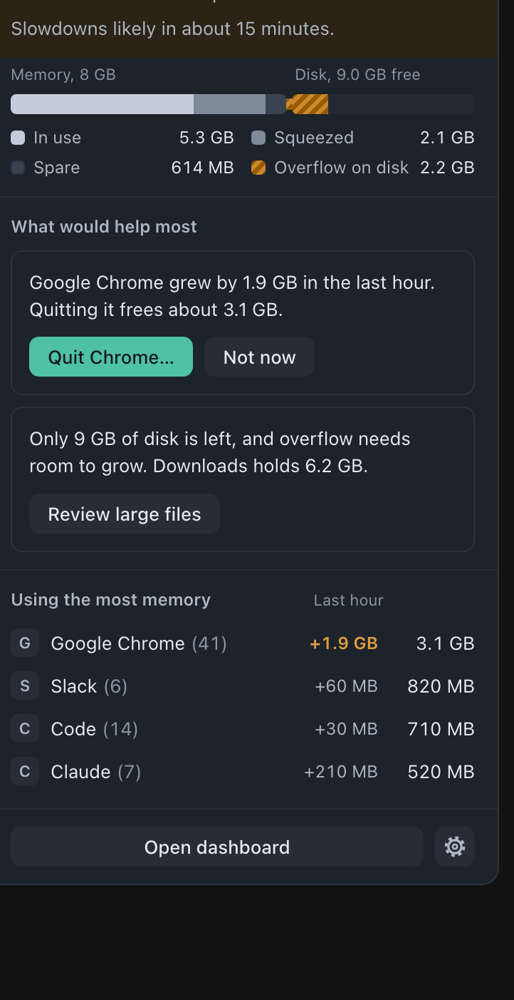
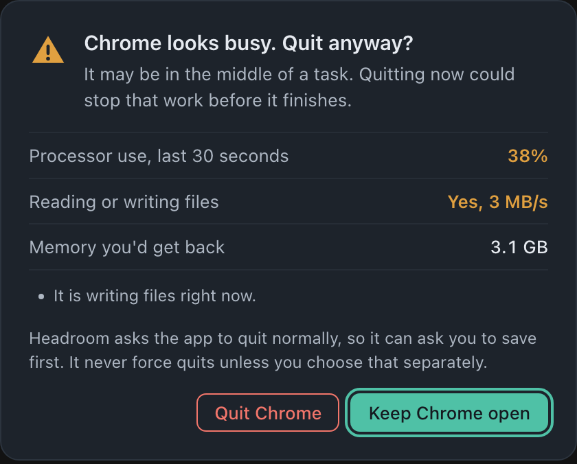
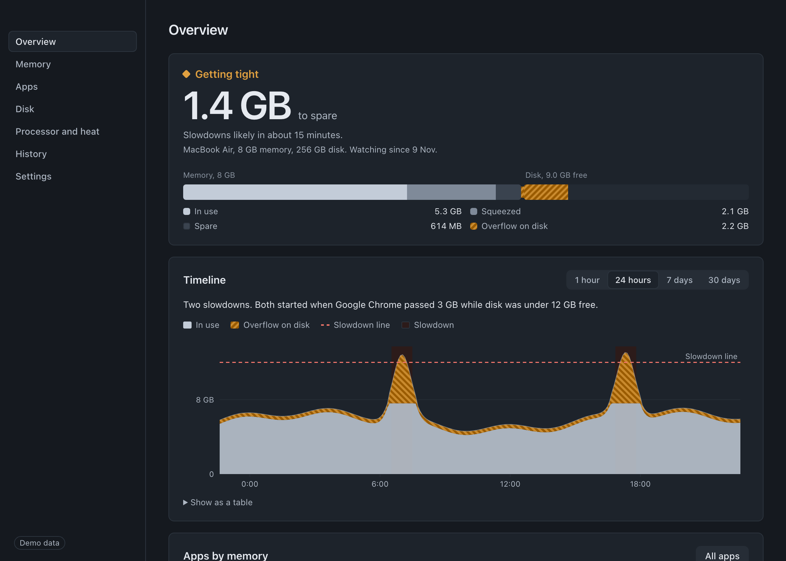

# Headroom

A small menu bar app that warns you **before** your Mac slows down.

Macs with little memory and a small disk (8 GB / 256 GB is common) stutter when memory fills up, macOS starts swapping to disk, and the disk is nearly full too. Headroom watches that whole chain. It tells you how much room is left ("1.4 GB to spare"), predicts when a slowdown is coming, names the app causing it, and offers safe fixes.

<p>
  
  &nbsp;
  
</p>



*Screenshots use synthetic demo data.*

## What it does

* **Menu bar icon** that fills as memory is used and changes colour only when things get tight.
* **Dropdown** with how much room is left, a memory and disk "runway" bar, the apps using the most memory, and up to two suggestions.
* **Forecast:** "Slowdowns likely in about 15 minutes", shown only when the trend is clear.
* **Culprit:** the app that grew the most, and how much quitting it would free.
* **Notifications** when the state gets worse, with a "Quit [App]…" button that opens the safety check (never quits directly).
* **Safe fixes:**
  * Quit an app: Headroom first checks whether it looks busy (processor, disk, child processes), then asks it to quit normally so it can ask you to save. Force quit is off by default and needs a second confirmation.
  * Free disk space: shows what Downloads, caches, the Trash and developer leftovers hold, and moves what you pick **to the Trash**. Headroom never deletes files.
  * System apps and Headroom itself are protected and can't be quit.
* **Dashboard** with a timeline of past slowdowns and what caused them, per-app history, disk, processor and heat, history export and settings.
* **Learns your Mac:** every threshold comes from the machine it runs on (memory, disk size, model), and after a week it adjusts to where this Mac actually struggled. It never becomes less cautious than the defaults.

## Install

1. Download `Headroom.dmg` from the [latest release](../../releases/latest).
2. Open it and drag **Headroom** to **Applications**.
3. Headroom isn't signed with an Apple Developer ID, so macOS blocks it the first time. To allow it once:
   1. Open Headroom from Applications. macOS says it can't verify it; click **Done** (or **Cancel**).
   2. Go to **System Settings › Privacy & Security**, scroll down, and click **Open Anyway** next to the Headroom message. Confirm with your password or Touch ID.

   After that it opens normally. (On macOS 13 and 14 you can instead right-click Headroom, choose **Open**, then **Open** again.)
4. Headroom appears in the menu bar. It asks once to send notifications and adds itself to your login items. You can turn either off in its Settings. Right-click the menu bar icon to open the dashboard or quit Headroom.

Requires macOS 13 Ventura or later, Apple Silicon or Intel.

To uninstall: quit Headroom (right-click the menu bar icon › Quit Headroom), drag it to the Trash, and remove `~/Library/Application Support/Headroom`.

## Privacy

Headroom has **no network code at all**: no telemetry, analytics, crash reports or update checks. It runs as you, never asks for admin rights or Full Disk Access, and keeps its history in one local file you can export or delete from Settings. Tests fail the build if a networking package is ever imported. Details: [docs/PRIVACY.md](docs/PRIVACY.md).

## Performance

Measured over 10 minutes on an Apple Silicon Mac in normal use with the dropdown and dashboard closed (`scripts/measure.sh`):

| | Measured | Target |
|---|---|---|
| Processor, main process (average) | **0.89%** of one core | under ~1% |
| Processor, web view processes (average) | 0.01% of one core | |
| Memory, main process (peak physical footprint) | **45 MB** (42 MB average) | under ~60 MB |
| Memory, web view processes (resident) | about 12 MB | |

Headroom reads the system every 5 seconds (every 2 seconds while a panel is open) and the process list every 10 seconds. The dashboard and safety windows are only created when you open them and are destroyed when closed, so a closed dashboard costs nothing. The expensive disk capacity query runs once a minute. Run `scripts/measure.sh build/out/Headroom.app 10` to measure your own Mac.

## Build from source

You need macOS 13+, Go 1.26+, Node 20+ and the Xcode command line tools.

```bash
git clone https://github.com/Prime-Cave/headroom.git
cd headroom
make app      # build/out/Headroom.app, universal, ad-hoc signed
make dmg      # build/out/Headroom.dmg
make check    # vet, race tests, lint, frontend typecheck and contrast check
```

Try it on synthetic data without touching anything on your Mac:

```bash
HEADROOM_DEMO=tight build/out/Headroom.app/Contents/MacOS/Headroom
```

Watch it react to real memory pressure (allocates memory in a capped child process, then gives it back):

```bash
make stress
```

Step by step, including tools to install and troubleshooting: [docs/SETUP.md](docs/SETUP.md). More: [CONTRIBUTING.md](CONTRIBUTING.md), [docs/ARCHITECTURE.md](docs/ARCHITECTURE.md), [docs/RELEASING.md](docs/RELEASING.md).

## Security

Please report vulnerabilities privately through GitHub security advisories. See [SECURITY.md](SECURITY.md).

## License

[MIT](LICENSE)
