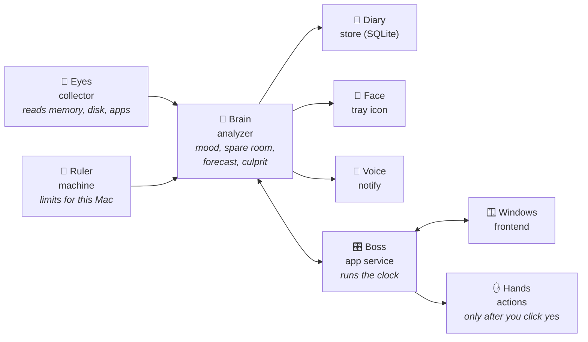
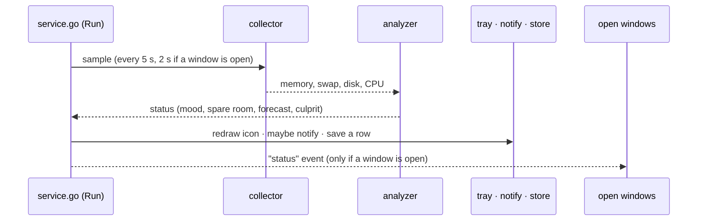
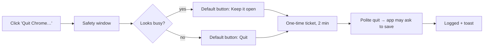
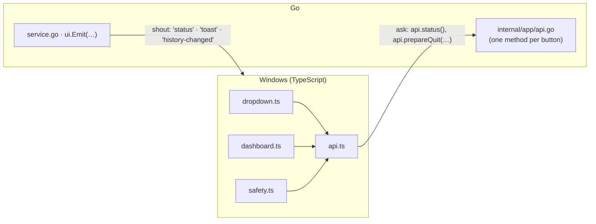

# How Anti-Freeze works

A plain-language tour of the codebase: what each part does, what happens every few seconds, and which file to open when you want to change something. For the exact formulas and design decisions, see [ARCHITECTURE.md](ARCHITECTURE.md). To get it running, see [SETUP.md](SETUP.md).

**Contents:** [The big idea](#the-big-idea-a-desk-and-a-closet) · [The map](#the-map) · [Every 5 seconds](#what-happens-every-5-seconds) · [The helpers](#the-helpers-one-by-one) · [The three moods](#the-three-moods) · [Spare room](#how-14-gb-to-spare-is-counted) · [Forecast](#the-forecast) · [Quitting safely](#how-quitting-an-app-stays-safe) · [The windows](#how-the-windows-talk-to-go) · [Change X → open Y](#i-want-to-change-x-open-this-file) · [Commands](#commands-youll-use) · [House rules](#house-rules-the-code-protects)

## The big idea: a desk and a closet

> **Like you're five:** imagine you're playing with toys on a **desk**. The desk is your Mac's **memory**. When the desk gets full, you start putting toys in the **closet** down the hall. The closet is your **disk**, and that pile is called **swap**. Every time you need a toy from the closet you have to walk there and back, and that walking is what makes the Mac feel slow. If the closet gets full too, you're really stuck.

Anti-Freeze watches the desk *and* the closet together. It counts how much room is left ("1.4 GB to spare"), notices when the closet pile is growing fast, guesses when you'll run out, and points at the app taking the most space (usually a web browser).

The app draws this as the **runway bar** (`frontend/src/runway.ts`): memory on the left, disk on the right, overflow spilling from one into the other.

```
 memory (the desk)                         disk (the closet)
┌──────────────────┬───────┬────────┬╱╱╱╱╱╱┬──────────────────────┐
│  toys on desk    │squish │ spare  │ swap │     empty closet     │
└──────────────────┴───────┴────────┴╱╱╱╱╱╱┴──────────────────────┘
   in use           compressed        overflow       free disk
```

## The map

> **Like you're five:** the app is a little team. **Eyes** look at the Mac. A **brain** decides if things are okay. A **diary** writes it all down. A **face** in the menu bar shows the mood. A **voice** taps you on the shoulder with a notification. **Hands** do the fixing, but only when you say yes. And the **windows** are what you look at.



Everything lives in `internal/` except the windows (`frontend/`) and the startup code (`cmd/anti-freeze/`).

The code uses three languages:

* **Go** does the watching, thinking and remembering.
* **TypeScript** (in `frontend/`) draws the windows.
* A few small **Objective-C** files (`.m`) talk directly to macOS, because some Mac features can only be reached that way.

A framework called **Wails** glues the Go side and the windows together.

## What happens every 5 seconds

> **Like you're five:** it's like a lifeguard at a pool. Every few seconds they look up, check everyone's okay, and blow the whistle only if someone's in trouble. Most of the time they just look and go back to sitting.

1. **The clock ticks.** The loop in `internal/app/service.go` (`Run`) wakes up every **5 s**, or every **2 s** while a window is open so the numbers feel live.
2. **The eyes look.** The collector reads memory, swap, disk and processor from macOS (`internal/collector/native_darwin.*`). Every **10 s** it also reads the full list of running apps, which is the expensive part.
3. **The brain thinks.** The analyzer works out the mood, the "to spare" number, a forecast and which app to blame (`internal/analyzer/analyzer.go` → `AddSystem`).
4. **The face updates.** The menu bar icon is redrawn if the mood or fill changed (`internal/tray`).
5. **The voice decides.** If things just got *worse*, the notifier may send one notification. It won't repeat the same reason within 20 minutes (`internal/notify`).
6. **The diary writes.** One row goes into the SQLite database (`internal/store`). Once a minute, old rows are squashed into 1-minute and 10-minute summaries so the file stays small.
7. **The windows hear about it.** If a window is open, the new status is sent to it as a `"status"` event and the screen redraws.



## The helpers, one by one

Each entry is one folder. The italic line is the five-year-old version; the rest is the grown-up version.

### Startup — `cmd/anti-freeze/`
*The person who turns on all the lights in the morning.*
`main.go` builds every helper, makes the menu bar item and its right-click menu, and starts the loop. `ui.go` opens and closes the windows. `demo.go` is the fake-data mode. `notifier.go` connects real macOS notifications and login items.

### Eyes — `internal/collector/`
*Peeks at the desk and closet and counts everything.*
Asks macOS for memory, swap, disk, processor, heat and the app list, using public Apple APIs (in C and Objective-C). `groups.go` bundles helper processes into their app, so "Chrome" is one row, and marks system apps as protected. `fake.go` replays made-up data for tests and demo mode.

### Ruler — `internal/machine/`
*Measures how big* your *desk is, so "full" means full for you.*
Detects the Mac's model, memory and disk on first run and turns them into thresholds. For example, the disk reserve is 10% of the disk, between 8 and 16 GB. The Relaxed / Balanced / Early setting scales them.

### Brain — `internal/analyzer/`
*Decides "all good", "careful", or "uh-oh".*

| File | What it does |
|---|---|
| `state.go` | The mood rules, plus the "calm down slowly" rule: a better mood must hold for 60 s before it shows |
| `spareroom.go` | The "to spare" maths |
| `forecast.go` | Draws a line through recent numbers to guess the future |
| `apps.go` | Finds the app to blame |
| `episodes.go` | Remembers each slowdown, and slowly learns this Mac's real limits |

### Diary — `internal/store/`
*A notebook that remembers yesterday, but tears out very old pages.*
A SQLite file in `~/Library/Application Support/Anti-Freeze/`. Detailed rows are kept briefly, then 1-minute and 10-minute summaries for up to 90 days. It also holds your settings, past slowdowns and a log of everything the app did. `export.go` writes the CSV export.

### Face — `internal/tray/`
*The little picture that changes its expression.*
`icon.go` draws the menu bar icon in pure Go, pixel by pixel: grey and calm, amber outline, or solid red with "!". A tiny Objective-C file hands the picture to macOS.

### Voice — `internal/notify/`
*Taps your shoulder, but never nags.*
Decides *whether* to notify and writes the words, like "Chrome is using 3.1 GB and still growing." It only notifies when things get worse, at most once per reason every 20 minutes, and respects Focus.

### Hands — `internal/actions/` and `internal/macos/`
*Only touches things after you say "yes, please".*
`quit.go` runs the safety check and quits apps politely. `disk.go` measures a fixed list of folders and moves things to the Trash; it never deletes. `internal/macos` is the Objective-C that actually talks to Finder, the Trash and other apps.

### Boss — `internal/app/`
*The grown-up who holds the clipboard and tells everyone when to go.*

| File | What it does |
|---|---|
| `service.go` | Runs the loop and holds the latest status |
| `api.go` | The list of buttons the windows are allowed to press |
| `actions.go` | Wires those buttons to the hands |
| `settings.go` | Checks and stores your settings |

### Windows — `frontend/`
*The pictures you actually look at and click.*
Three pages: `index.html` (the dropdown), `dashboard.html` and `safety.html`, each with a matching `.ts` file in `src/`. `api.ts` talks to Go. `mock.ts` pretends to be Go, so you can design in a normal browser. Colours live in `styles/tokens.css`.

### Rule-checker — `internal/policy/`
*A hall monitor that checks the code itself.*
It has no app code, only tests. They fail the build if anyone adds networking or shell commands to the app. This is how "no network, ever" stays true.

### Toolbox — `scripts/`, `build/`, `.github/`
*The garage with the tools for building and testing.*

| Folder | What's in it |
|---|---|
| `scripts/stress` | Fills memory on purpose, to test the app |
| `scripts/fixtures` | Makes fake data |
| `build/darwin` | The app's Info.plist and icon |
| `.github/workflows` | Runs the tests and security scans on GitHub, and builds the release DMG |

## The three moods

The rules live in `internal/analyzer/state.go` (`Evaluate`). The names are the exact text from `Label()`.

| Mood | Icon | When |
|---|---|---|
| **Plenty of room** | plain grey, small bar showing memory used | none of the warning signs below |
| **Getting tight** | amber outline, tall bar | memory pressure is "warn", *or* swap is growing fast, *or* free disk is below the reserve, *or* swap has passed a level where this Mac struggled before |
| **Slowdown likely** | solid red with "!" | pressure is "critical", *or* the forecast says trouble within 5 minutes, *or* free disk is below the hard floor |

> **Like you're five:** getting worse happens **right away**. Getting better has to stay better for a whole **minute** first. That stops the icon flickering back and forth, like how you wait a minute after crying before saying "I'm fine now".

## How "1.4 GB to spare" is counted

> **Like you're five:** count the empty spots on the desk. Add the toys you could put away in a second (cached files). Then add a *small*, safe amount of closet space, but never so much that the closet gets crowded.

```
spare room = free + cached files + purgeable + safe swap allowance

safe swap  = the smaller of:
             (swap budget − swap already used)   ← budget is half your memory
             (free disk − disk reserve)          ← keeps the closet from filling
```

The code is in `internal/analyzer/spareroom.go`. If macOS won't report a number, it counts as zero and the screen says "Not available on this Mac" instead of pretending.

## The forecast

> **Like you're five:** if the closet pile grows by one toy every minute and there's room for ten more, you have about ten minutes. That's the whole trick: draw a straight line and see where it hits the wall.

```
 room used
   ▲                                        ● ← "Slowdowns likely in about 15 minutes"
   │- - - - - - - - - - - - - - - - - - - -/- -  limit: no room left
   │                                 . ·´
   │                          . · ´    (the guess)
   │                  ___●  ´
   │          ___---´   now
   │  ___---´    (what really happened)
   └──────────────────┼────────────────────────▶ time
     10 min ago       now                  +15 min
```

The code is in `internal/analyzer/forecast.go`. It only speaks up when the trend is clear: enough points and a steady line. Otherwise it says "Steady. Nothing is filling up fast."

## How quitting an app stays safe

> **Like you're five:** before you take away someone's toy, you check: are they still playing with it? Then you ask nicely, so they can put it away themselves. You never just snatch it.

1. **You click "Quit Chrome…".** A safety window opens instead of the app quitting (`frontend/src/safety.ts`).
2. **The safety check.** `PrepareQuit` in `internal/actions/quit.go` looks at the last 30 seconds. Is the app using over 10% of the processor? Writing to disk? Running child processes, such as a build? If it looks busy, the default button becomes "Keep it open".
3. **A one-time ticket.** The check hands back a secret token that works once, for 2 minutes. A quit without that token is refused, so no other code path can quit an app by accident.
4. **A polite quit.** `ConfirmQuit` asks macOS to quit the app normally, so it can ask "Save your changes?". Force quit is hidden and needs a typed confirmation.
5. **It's written down.** The action and how much memory it freed go into the diary and show as a toast.



The Trash works the same way. `PlanTrash` lists exactly what will move and the total size, and gives a one-time ticket. `ConfirmTrash` then moves the items. Only the folders listed in `disk.go` can be touched.

## How the windows talk to Go

> **Like you're five:** the windows and the Go side are like two kids with walkie-talkies. A window can **ask** a question ("what's the status?") and get an answer. And Go can **shout** news to everyone listening ("status changed!").



A name in `api.ts`, like `"PrepareQuit"`, must match a method on `API` in `api.go` exactly. `mock.ts` fakes all of these when you run the pages in a normal browser.

| Window | Files | What it is |
|---|---|---|
| Dropdown | `index.html` · `dropdown.ts` | Opens when you click the icon. Shows the big "to spare" number, the runway bar, the top memory users and up to two suggestions. |
| Dashboard | `dashboard.html` · `dashboard.ts` | Overview, timeline chart (`chart.ts`), apps, disk, history and settings. It is created only when you open it and destroyed when you close it. |
| Safety check | `safety.html` · `safety.ts` | The "Quit this app?" window, with the busy check and the Keep it open / Quit buttons. |

## "I want to change X." Open this file.

| I want to… | Go here |
|---|---|
| Change words in the dropdown or dashboard | `frontend/src/dropdown.ts`, `frontend/src/dashboard.ts` |
| Change colours, corners, fonts | `frontend/src/styles/tokens.css` (then the page's own `.css` file) |
| Rename the moods ("Getting tight") | `internal/analyzer/state.go` → `Label()` |
| Make it warn earlier or later | `internal/machine/profile.go` → `Defaults()` and `Apply()` |
| Check more or less often | `internal/app/service.go` → `SlowInterval`, `FastInterval`, `ProcessInterval` |
| Change a notification's wording | `internal/notify/notify.go` → `Compose()` |
| Change how often it can notify | The default is 20 min: `internal/app/settings.go` → `DefaultSettings()` |
| Change the menu bar icon's look | `internal/tray/icon.go` → `draw()` |
| Protect another app from being quit | `internal/collector/groups.go` → `protectedNames` |
| Add a folder to the disk cleanup list | `internal/actions/disk.go` → `places` |
| Change what counts as "busy" before quitting | `internal/actions/quit.go` → `BusyCPU`, `BusyDiskRate` |
| Change the right-click menu | `cmd/anti-freeze/main.go` (search for `"Open dashboard"`) |
| Add a new setting | `internal/app/settings.go` (`Settings`, `DefaultSettings`, `loadSettings`, `validSetting`), then a row in the Settings part of `dashboard.ts`, then the type in `types.ts` |
| Add a new button that calls Go | A new method on `API` in `internal/app/api.go` → the same name in `frontend/src/api.ts` → a fake answer in `mock.ts` |
| Store something new in the database | **Add** a new entry at the end of `migrations` in `internal/store/store.go`. Never edit an old one: people's existing databases have already run it. |

## Commands you'll use

Run these from the repository folder. They're all defined in the `Makefile`. [SETUP.md](SETUP.md) lists the tools you need first.

| Command | What it does |
|---|---|
| `make app` | Builds `build/out/Anti-Freeze.app`. Run it after any change. |
| `ANTIFREEZE_DEMO=tight build/out/Anti-Freeze.app/Contents/MacOS/Anti-Freeze` | Runs the app with pretend data (`ok`, `tight`, `critical`, `recover`). It's safe: it never quits or moves anything. |
| `npx --prefix frontend vite frontend` | Opens the windows in your normal browser with fake data. Best for design work. Try `localhost:5173/?state=critical`. |
| `make test` | Runs all the Go tests. Quick. |
| `make check` | The full check-up GitHub runs: tests, lint, type checks, colour contrast. |
| `make stress` | Fills memory on purpose so you can watch the icon change. It gives the memory back after 2 minutes, or press Ctrl-C. |

## House rules the code protects

* **No internet, ever.** Adding a networking package makes the `internal/policy` tests fail.
* **Never deletes files.** Only "Show in Finder" or "Move to Trash", after you confirm.
* **Never quits on one click.** The safety check and one-time ticket are required.
* **No admin rights.** It runs as you and never asks for a password.
* **No shell commands.** The policy tests ban `os/exec` too.
* **Migrations only get added.** The old ones in `store.go` are frozen forever.

Run `make check` before you push. If it passes on your Mac, it almost always passes on GitHub too. To ship a new version, follow [RELEASING.md](RELEASING.md).
